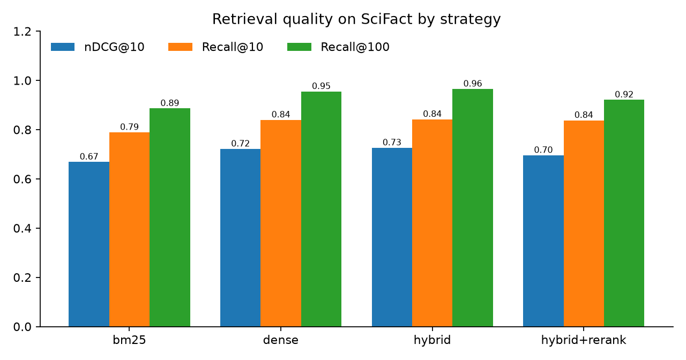
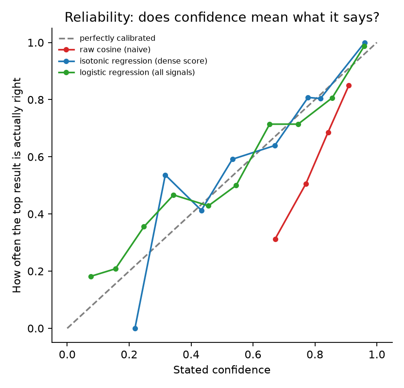
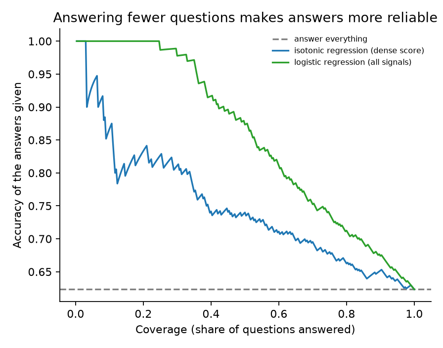

# ragbench

[](https://github.com/Saagnik-Mondal/ragbench/actions/workflows/ci.yml)

**A retrieval-augmented QA system that measures its own retrieval quality.** It compares four retrieval strategies (BM25, dense embeddings, hybrid, and hybrid with a cross-encoder reranker) on a public benchmark, and serves the best ones through an API with cited answers.

Most RAG demos never check whether retrieval actually works. This project treats retrieval as something to measure, and the measurements changed what I would ship.

## Results

**In plain terms:** the best setup (hybrid) finds about 84% of the correct papers within its first 10 results, compared with about 79% for ordinary keyword search. The table below has the details, and a short key to the metric names follows it.

Benchmark: [BEIR SciFact](https://github.com/beir-cellar/beir) (5,183 scientific abstracts, 300 test claims with expert relevance labels). Embeddings: `BAAI/bge-small-en-v1.5` (quantized ONNX). Reranker: `ms-marco-MiniLM-L-6-v2` cross-encoder over the top 30 hybrid candidates.

| Strategy | nDCG@10 | Recall@10 | Recall@100 | MRR@10 | Mean latency |
|---|---:|---:|---:|---:|---:|
| BM25 | 0.669 | 0.789 | 0.886 | 0.638 | 7.9 ms |
| Dense (bge-small) | 0.721 | 0.840 | 0.955 | 0.689 | 30 ms |
| **Hybrid (BM25 + dense, RRF)** | **0.726** | **0.842** | **0.965** | **0.695** | 59 ms |
| Hybrid + cross-encoder rerank | 0.696 | 0.838 | 0.921 | 0.659 | 3,145 ms |



Latency is mean time per query on a standard GitHub Actions runner (CPU only, one query at a time). Raw numbers are in [`results/benchmark.json`](results/benchmark.json); the run that produced them is reproducible from the Actions tab (see below).

### How to read these numbers

Each of the 300 test questions has a few papers that experts marked as correct. The system returns a ranked list of papers for each question, and these metrics score that list. All of them run from 0 to 1, and higher is better. These are the standard retrieval measures used by the BEIR benchmark, so results can be compared with other work.

| Metric | In plain words |
|---|---|
| **Recall@10** | Of the correct papers, what share appears in the top 10 results. |
| **Recall@100** | The same, but for the top 100. It shows whether the correct papers were found at all, which matters if a later step re-sorts the list. |
| **MRR@10** | How high the first correct paper is ranked. 1st place scores 1, 2nd scores 0.5, 5th scores 0.2, averaged over all questions. |
| **nDCG@10** | One overall quality score for the top 10. It rewards putting correct papers near the top, and 1.0 would be a perfect ordering. It is the headline metric of BEIR. |

### What the numbers say

1. **Hybrid retrieval is the best default.** Fusing BM25 and dense rankings with reciprocal rank fusion lifts nDCG@10 from 0.669 (BM25) to 0.726, about 8.5% relative, for roughly 51 ms extra per query. It also has the best recall at 100, which matters when a downstream step needs a good candidate pool.
2. **The reranker did not help on SciFact.** Adding a general-purpose cross-encoder lowered nDCG@10 from 0.726 to 0.696 and made queries about 50x slower. The reranker was trained on web search passages, while SciFact queries are scientific claims, so the mismatch is plausible. I did not test a domain-tuned reranker, so this is a result for this model on this dataset. On a second dataset the answer was different (next section). Note that the reranked row's Recall@100 is not comparable with the others: the reranker only reorders its top 30 candidates, so it cannot retrieve more than 30 documents.
3. **The harness checks out.** BM25 scores 0.669 nDCG@10, close to the roughly 0.665 reported for BM25 on SciFact in the BEIR paper, which is a useful sanity check that the metrics are implemented correctly.

### Do the findings hold on a second dataset?

I ran the same benchmark on [BEIR NFCorpus](https://www.cl.uni-heidelberg.de/statnlpgroup/nfcorpus/) (nutrition and medical questions, 3,633 documents, 323 test queries). Full results: [`results/nfcorpus/`](results/nfcorpus/benchmark.md).

| Strategy | nDCG@10 | Recall@10 | MRR@10 | Mean latency |
|---|---:|---:|---:|---:|
| BM25 | 0.311 | 0.153 | 0.522 | 1.8 ms |
| Dense (bge-small) | 0.343 | 0.163 | 0.533 | 15 ms |
| Hybrid (BM25 + dense, RRF) | 0.346 | 0.165 | 0.558 | 22 ms |
| Hybrid + cross-encoder rerank | **0.362** | **0.170** | **0.579** | 2,971 ms |

- **Hybrid beating BM25 holds.** nDCG@10 is 11.4% higher (0.346 vs 0.311), compared with 8.5% on SciFact. The gap between dense and hybrid is small here (0.343 vs 0.346) and I did not test whether it is significant; hybrid was not worse than dense on either dataset.
- **The reranker conclusion does not hold.** On NFCorpus the reranker improves nDCG@10 from 0.346 to 0.362 (+4.6%), where on SciFact it lowered it by 0.030. It is still about 133 times slower (2,971 ms against 22 ms per query). So whether reranking pays for itself depends on the dataset, and I would not claim a general rule from two datasets.

Reproduce: `uv run python -m ragbench.evaluate --dataset nfcorpus`, or run the **Benchmark** workflow and choose `nfcorpus`.

## Can you trust the retriever's confidence?

A RAG system should know when it is probably wrong. Many demos use the raw similarity score as a "confidence", but nothing guarantees that a score of 0.8 means "right 80% of the time". I tested that on SciFact: for each claim, is the hybrid retriever's top result a paper the experts marked as correct? (It is for 62.3% of the 300 test claims.) Then I compared ways of turning retrieval signals into a probability, and checked whether that probability lets the system safely say "I'm not sure".

No leakage: calibrators were fit on 566 SciFact train claims, abstention thresholds were chosen on 243 other train claims, and the 300 test claims were used once for the numbers below. Full table with confidence intervals: [`results/calibration.md`](results/calibration.md).

| Confidence method | ECE (lower is better) | Brier | AUROC (higher is better) |
|---|---:|---:|---:|
| Raw cosine score, used as a probability | 0.193 | 0.260 | 0.667 |
| Platt scaling (dense score) | 0.066 | 0.220 | 0.667 |
| Histogram binning (dense score) | 0.051 | 0.222 | 0.652 |
| Isotonic regression (dense score) | 0.059 | 0.222 | 0.655 |
| Logistic regression on all signals | 0.060 | **0.162** | **0.837** |

ECE (expected calibration error) measures the gap between stated confidence and how often the answer is really right. AUROC measures how well the confidence separates right answers from wrong ones.



1. **The raw score is badly overconfident.** Its ECE is 0.193 (95% CI 0.139 to 0.250). Calibration cuts it to 0.05 to 0.07, and the intervals do not overlap (for example isotonic: 0.043 to 0.123).
2. **Calibrating one score does not make the system better at choosing what to answer.** AUROC stays at 0.65 to 0.67 for every single-score method. That is expected: a monotone fix to one number cannot change the ranking of answers. It only makes the stated probabilities honest.
3. **Combining signals does.** A logistic model over eight signals (dense and BM25 scores, score margins, whether the two retrievers agree, fused score, query length) lifts AUROC to 0.837 and cuts Brier from 0.222 to 0.162.
4. **That is what makes abstaining useful.** At about the same answer precision, the multi-signal confidence answers far more questions:

| Method | Questions answered | Precision of those answers |
|---|---:|---:|
| Raw cosine (threshold for 90% target) | 15.7% | 85.1% |
| Logistic on all signals (threshold for 90% target) | 54.0% | 84.0% |



**An honest caveat:** thresholds picked on 243 held-out claims did not hit their targets exactly on the test set (a 90% target delivered about 84 to 85%). With samples this small, a threshold is an estimate, not a guarantee. Other limits: "correct" means the top result is in SciFact's expert-labelled relevant set, so a good but unlabelled paper counts as wrong; one dataset; one embedding model.

Reproduce: `uv run python -m ragbench.calibrate_eval` (needs `uv sync --extra calib`), or run the **Calibration experiment** workflow in the Actions tab. The calibration code is in [`calibration.py`](src/ragbench/calibration.py) and [`calibrate_eval.py`](src/ragbench/calibrate_eval.py); ECE, Brier, histogram binning and the risk-coverage and threshold logic are written from scratch and tested.

## What is in the box

- **Retrieval strategies** behind one interface: BM25, dense, hybrid (reciprocal rank fusion), and two-stage rerank. See [`retrievers.py`](src/ragbench/retrievers.py).
- **Metrics written from scratch** (nDCG, Recall@k, MRR) with graded relevance, and unit-tested against hand computations. See [`metrics.py`](src/ragbench/metrics.py).
- **Evaluation harness** that runs every strategy over a labelled dataset and writes a table, JSON and chart. See [`evaluate.py`](src/ragbench/evaluate.py).
- **FastAPI service**: `/search`, `/ask` (answer with citations), `/strategies`, `/health`, and a small web page at `/` that compares strategies side by side.
- **Two answer backends**: an offline extractive backend that always works, and a Claude backend (set `ANTHROPIC_API_KEY`) that must cite passage numbers.
- **Tests and CI**: 20 tests, lint and format checks on every push (GitHub Actions), plus a one-click benchmark workflow.

## Architecture

```
                         question
                            |
          +-----------------+-----------------+
          |                                   |
      BM25 (lexical)                  Dense (bge-small)
          |                                   |
          +---------- reciprocal rank --------+
                         fusion
                            |
                  (optional) cross-encoder
                       rerank top 30
                            |
                     top-k passages
                            |
              +-------------+-------------+
              |                           |
        extractive answer          Claude answer
        (offline, cited)        (needs API key, cited)
```

## Quickstart

Requires [uv](https://docs.astral.sh/uv/).

```bash
git clone https://github.com/Saagnik-Mondal/ragbench.git
cd ragbench
uv sync --extra dev --extra bench
uv run pytest                 # 20 tests, no downloads needed
```

Run the API and UI:

```bash
uv run ragbench-serve         # http://localhost:8000
```

The first start downloads SciFact and the two models, then embeds all 5,183 documents. That took about 17 minutes on a CPU runner; the vectors are cached in `data/cache`, so later starts are fast. To skip the reranker (and its download), set `RAGBENCH_NO_RERANK=1`.

Try it:

```bash
curl -s localhost:8000/ask -H 'content-type: application/json' \
  -d '{"query": "Does vitamin D reduce fracture risk?", "strategy": "hybrid", "k": 5}'
```

To use Claude for answers, install the extra and set a key:

```bash
uv sync --extra llm
export ANTHROPIC_API_KEY=...   # optional; without it the offline backend is used
```

A `Dockerfile` is included that bakes the dataset and models into the image.

## Reproduce the benchmark

On GitHub (no local compute): open the **Actions** tab, choose **Benchmark**, and click **Run workflow**. It runs the full evaluation and saves `results/` as a downloadable artifact.

Locally:

```bash
uv run python -m ragbench.evaluate               # full run, all four strategies
uv run python -m ragbench.evaluate --no-rerank   # skip the slow reranker
uv run python -m ragbench.evaluate --replot      # redraw the chart from saved results
```

## Design decisions

- **Reciprocal rank fusion over score blending.** BM25 and cosine scores live on different scales, so blending them needs tuning per dataset. RRF only uses ranks and has one well-behaved parameter.
- **ONNX embeddings through fastembed, not PyTorch.** The install stays small and runs on CPU-only machines and CI.
- **Retrievers share one `search(query, k)` interface** and the embedder and reranker are injected, so tests run in under a second with a deterministic hashing embedder and no model downloads.
- **An offline answer backend ships by default**, so the demo works without an API key and the citation behaviour is testable.

## Limitations

- One dataset (SciFact, about 5k documents). Rankings of strategies can change on other corpora, so treat the numbers as evidence for this setting.
- Only retrieval is measured. Answer faithfulness and citation accuracy are not evaluated yet.
- One reranker model and a fixed candidate depth of 30 were tested; I did not tune either or try a domain-specific reranker.
- Latency is single-query on a CI runner, not a load test.

## Project layout

```
src/ragbench/
  data.py          dataset download and loading
  retrievers.py    BM25, dense, hybrid (RRF), rerank
  metrics.py       nDCG, Recall@k, MRR
  evaluate.py      benchmark harness and chart
  generate.py      extractive and Claude answer backends
  api.py           FastAPI app
  static/          web UI
tests/             20 unit and API tests
results/           benchmark.json / .md / .png
.github/workflows/ ci.yml and benchmark.yml
```

## License

MIT. See [LICENSE](LICENSE).
